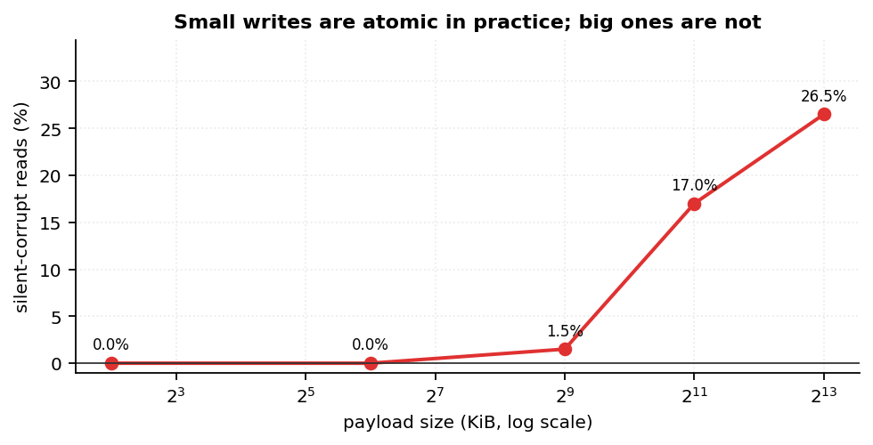

<h1 align="center">Dual6 · 二生三</h1>

<p align="center"><b>One 6-state symbol carries a binary bit and a balanced ternary trit.</b><br>
A storage container for the day a binary engine and a ternary engine have to read the same bytes.</p>

<p align="center">
  <b>English</b> · <a href="README.zh-CN.md">简体中文</a>
</p>

<p align="center">
  
  
  
  
  
</p>

<p align="center">
  
</p>

```text
d = 3·b + (t + 1)        b = d // 3        t = d % 3 - 1

d ∈ {0..5}   b ∈ {0,1}   t ∈ {-1, 0, +1}
```

> **This is a container, not an accelerator and not a numeric type.**
> `d` is a *symbol*, not a base-6 digit. No arithmetic is defined on it.

---

## Naming

A model stored in this format is **one `.p6` file** — `llama-3-8b.p6`,
`bitnet-2b.p6`, not a directory of shards and sidecars.

`6` is the first perfect number (1 + 2 + 3 = 6), and it is also where the
encoding comes from: **2 states × 3 states = 6 states**.

The Chinese name is **二生三** (*èr shēng sān*), from the *Tao Te Ching*: "the one
gives birth to the two, the two give birth to the three". Two (binary) giving
birth to three (ternary), inside one symbol.

## Where this came from

I wanted to know one thing: **if a machine ever had a binary datapath and a
ternary datapath side by side, how should the weights be stored so that both
can read them?**

Two answers are obvious and neither is good. Store two copies — now you have
two files, two checksums, two versions that can drift apart. Store one copy and
convert on read — now one engine always pays a conversion in its hot loop.

Dual6 is the third answer: put both views *inside* the symbol, so nobody
converts:

```text
d = 3·b + (t + 1)      one symbol, one bit, one trit
```

The bit channel is the quotient, the trit channel is the remainder. A binary
consumer never looks at the ternary digits and vice versa. Writing costs both
expansions once; reading costs neither.

The question that started it was curiosity, not a benchmark. The measurements
below are what I found when I went looking for an answer.

## Why

A ternary model stores 2 bits' worth of information in 1.58 bits of entropy.
A binary model wants plain bits. Today you pick one, or you store two copies
and keep them in sync.

Dual6 stores **one** artifact where:

- a binary consumer reads `d // 3` — a plain bit plane;
- a ternary consumer reads `d % 3 - 1` — 5 trits per byte, byte-identical to the
  existing 5-trit packing;
- neither needs a conversion step, a second read or a second checksum.

The two planes sit in one file, under one CRC, under one version number.

## Layouts

| Layout | Symbols | Bytes | Used bits |
|---|---:|---:|---:|
| interleaved | 5 | 13 | `D = Σ dᵢ·6ⁱ` |
| `D6-64` | 24 | 8 | 63 / 64 |
| `D6-128` | 48 | 16 | 125 / 128 |
| `D6-40` | 40 | 13 | 104 / 104 |

| Dual-plane block | Bit plane | Trit plane | Total |
|---|---:|---:|---:|
| `D6-64-DP` | 3 B | 5 B | 8 B |
| `D6-128-DP` | 6 B | 10 B | 16 B |
| `D6-40-DP` | 5 B | 8 B | 13 B |

## Frames

| Frame | Header | Integrity | Purpose |
|---|---|---|---|
| `D6P0` | 17 B | — | minimal |
| `D6P1` | 20 B | CRC32 | one dual-plane stream |
| `D6P2` | 33 B | CRC32 | dtype, flags, block metadata |

Two `D6P2` options:

| Option | Effect |
|---|---|
| `FLAG_OMIT_BIT_PLANE` | drop the bit plane — pure-ternary payloads at **1.6 bpw** instead of 2.6 |
| `layout = 1` | compacted bit plane — one flag bit per block, bitmaps only for blocks with a set bit |

## Quick start

```bash
pip install -e .                  # from the repository root
python run_tests.py               # 283 tests
python tools/build_native.py      # optional: Rust extension (faster, same bytes)
```

```python
import dual6

bits  = [1, 0, 1, 1]
trits = [1, -1, 0, 1]

symbols = dual6.mux(bits, trits)                  # [5, 0, 4, 5]
assert dual6.demux(symbols) == (bits, trits)      # both views, no conversion

frame = dual6.pack_dual_plane_v2(bits, trits)     # D6P2, header + CRC32
assert dual6.unpack_dual_plane_v2(frame)[:2] == (bits, trits)
```

### Memory-mapped frames

Reading a large frame does not have to copy it:

```python
from dual6 import MappedFrame, pack_dual_plane_v2, write_frame

frame = pack_dual_plane_v2([1, 0, 1, 1], [1, -1, 0, 1])
write_frame("tiny-model.p6", frame)

with MappedFrame("tiny-model.p6") as m:
    version, bits, trits, meta = m.unpack()       # version ∈ {0, 1, 2}
```

### Rust

The core is a normal crate. It is **not** on crates.io, so depend on it by path
or by git:

```toml
[dependencies]
dual6-core = { path = "crates/dual6-core" }
# dual6-core = { git = "https://github.com/duyumengcctv/dual6", package = "dual6-core" }
```

```rust
let symbols = dual6_core::mux(&bits, &trits)?;
let (bits, trits) = dual6_core::demux(&symbols)?;
```

`DUAL6_BACKEND=ref|native|auto` picks the Python implementation; the two are
required to produce byte-identical output.

## Measurements

Raw data in [`benchmarks/`](benchmarks/README.md) — five CSVs and three charts,
each with a note describing the method and the machine.

| What was measured | Result |
|---|---|
| trit-only `D6P2` vs `TQ1_0` | **1.60 bpw / 59.2 ns** per element vs 1.60 bpw / 59.3 ns — same byte layout, plus a CRC and a frame header |
| compacted bit plane, clustered masks | **−25% to −33%** at 5% density; **+1.5%** when the mask is periodic |
| in-place same-size overwrite, naive loader | silent corruption starts between **64 KiB and 512 KiB**; 26.5% of reads at 8 MiB |

<p align="center">
  
</p>

## What came of it

**It is not faster, and the repository should be read that way.**

| Question | Answer |
|---|---|
| Is decoding cheaper? | No. The trit plane is the existing 5-trit packing, so it costs the same: trit-only frame **1.60 bpw / 59.2 ns** vs `TQ1_0` 1.60 bpw / 59.3 ns. |
| Is storage cheaper? | Not for two channels: **2.6 bpw** against 1.6 for pure ternary — a 62.5% premium. Drop the bit plane and it lands back at 1.6. |
| Is a single frame faster to load? | No. Equivalent within ±5% at best, consistently ~2% slower in repeated runs. |
| Does the second channel pay for itself? | Only if something actually reads it. In a fused GEMV that consumes both channels, the cost roughly doubles. |

Three things did survive:

1. **Trit-only frames reach parity with the existing packing** (1.60 bpw, same
   decode cost) while adding a CRC32 and a single-object frame — that is a
   free integrity check for a pure-ternary payload.
2. **A compacted bit plane pays when the bit channel is a clustered mask**
   (−25% to −33% at 5% density), and costs 1.5% when the mask is periodic.
   The rule is empty-block share, not density.
3. **The most useful result was not the encoding.** Injecting faults into four
   containers under three update protocols showed that silent corruption is
   decided by *a checksum and an atomic rename*, not by how the bytes are
   packed — and that it only appears above a size threshold (between 64 KiB and
   512 KiB on this machine). That finding applies to any format, including the
   ones people already use.

So the honest summary: **a container that does one thing nothing else does
(one artefact, two views, one checksum, one version), at a storage cost that
only makes sense when both views are actually consumed.**

## Where it actually fits

Four situations. Each one names the condition that makes it *wrong*, because a
container that claims everything fits nothing.

**1 · A per-element side channel next to ternary weights** — `D6P2`, dual-plane

The case the format was designed for: a ternary value and a per-element flag
mask (outlier, prune, "use the high-precision copy") that the same kernel reads
in the same pass. One stream, no pointer chasing, no second file to fall out of
sync. With a clustered mask, `layout 1` adds **−25% to −33%** on top.

*Wrong when* the two channels are not element-aligned. That is most formats
today: AWQ and OWQ keep per-*channel* scales, SpQR and SqueezeLLM keep sparse
indices — both deliberately avoid an aligned second channel, which is exactly
what makes them cheap. **This scenario is currently hypothetical**; the
container is ready for it, not proof that it exists.

**2 · A pure-ternary model that wants one file and one checksum** — `D6P2`,
`FLAG_OMIT_BIT_PLANE`

Lands at **1.60 bpw and 59.2 ns/element**, the same as `TQ1_0` (1.60 / 59.3),
while adding a CRC32 and a single-object frame. Cheap for slow media and small
machines: one `open`, one `mmap`, one checksum.

*Wrong when* the data is already fast. A single frame is **not** faster to load
— measured equivalent at best, ~2% slower in repeated runs — so on an NVMe
drive or a cache-resident model the extra frame is pure overhead.

**3 · Hot-swapping a model while it is being served** — any frame, plus a protocol

Not a property of the container. Fault injection into four unrelated containers
showed that silent corruption is decided by **a checksum and an atomic rename**,
not by how the bytes are packed. A plain GGUF wrapped in a manifest gets the
same protection.

*What the measurements do say*: an in-place same-size overwrite is invisible
below **64 KiB**, starts to tear at **512 KiB** (1.5% of reads), and reaches
**17% at 2 MiB** and **26.5% at 8 MiB**. If you rewrite a model file in place,
you are already exposed — whatever format it is in.

**4 · A loader that must be written in C, C++ or Rust** — `D6P1` / `D6P2`

One fixed header gives plane offsets; the bit plane is directly addressable and
the trit plane is the existing 5-trit/byte packing, so an existing ternary
kernel reads it unchanged. Embedding the container in an engine is a header
parse, not a parser.

*Careful with "zero copy"*: the bit plane is directly usable, the trit plane
still has to be unpacked — the way every 5-trit kernel already does.

**Where it does not fit**, stated plainly:

- pure ternary inference with no per-element metadata → use `TQ1_0`;
- anything that fits in cache → `int8` decodes an order of magnitude faster;
- cross-layer mixed precision, MoE routing tables, KV-cache layouts → the
  channels are not element-aligned, and none of the measurements apply;
- a general compression format → this is a container, not a codec.

The long version, with the measurements behind each row, is in
[`docs/13-use-cases.md`](docs/13-use-cases.md).

One sentence for a README badge: *if your model is pure ternary, use `TQ1_0`;
if you need one artefact that a binary and a ternary engine can both read, or
one file you can checksum and swap atomically, this is what that looks like.*

## Outlook

## Status

**Dormant, not abandoned.** The container works and is tested; nothing new is
being added while the premise is unproven.

The premise is narrow: a binary engine and a ternary engine reading **the same
element** in the same pass. Today that only half-exists — ternary models such as
BitNet store ternary values but compute in FP16, so the bit channel has no
consumer. Two signals would change that:

1. a public model format whose per-element metadata is read alongside the
   weights (not per-tensor scales, not sparse indices);
2. ternary *compute* executing natively, instead of being unpacked to float.

Until then this stays a container with a specification, an implementation and
measurements.

## Scope

**In scope** — the symbol, sequence/layout/block packing, frames, error codes,
single-channel adapters.

**Out of scope** — value interpretation, quantisation, dtype/shape metadata,
tensor operators, and any model-format connector. The container carries bytes;
it does not explain them.

## Documentation

| File | Contents |
|---|---|
| [`docs/00-scope.md`](docs/00-scope.md) | what belongs in the container |
| [`docs/01-symbol.md`](docs/01-symbol.md) | the 6-state symbol |
| [`docs/02-sequence.md`](docs/02-sequence.md) | `mux` / `demux` |
| [`docs/03-layout.md`](docs/03-layout.md) | interleaved, dual-plane, fixed blocks |
| [`docs/04-frame.md`](docs/04-frame.md) | `D6P0` / `D6P1` / `D6P2`, flags, layouts |
| [`docs/05-errors.md`](docs/05-errors.md) | error codes |
| [`docs/08-api.md`](docs/08-api.md) | public API |
| [`docs/11-exact-dual.md`](docs/11-exact-dual.md) | optional codec: one integer, two views |
| [`docs/12-arithmetic.md`](docs/12-arithmetic.md) | optional exact-dual arithmetic helper |
| [`docs/13-use-cases.md`](docs/13-use-cases.md) | where it fits, where it does not, what it waits for |
| [`benchmarks/README.md`](benchmarks/README.md) | what each CSV measured, on what machine |

## Repository layout

```text
python/dual6/      reference implementation (+ adapters, CLI, mmap)
crates/            dual6-core (Rust), dual6-py (PyO3), dual6-ffi (C ABI)
docs/              the specification, one topic per file
benchmarks/        5 CSVs + 3 charts from the measurement suite
tests/             283 tests, including spec-derived ones
examples/          three runnable programs
tools/             build_native.py, check_version.py, native_coverage.py
```

## Tests

```bash
python run_tests.py                        # 283
DUAL6_BACKEND=ref python run_tests.py      # reference backend only
cargo test -p dual6-core                   # Rust core
```

[`tests/test_spec_from_scratch.py`](tests/test_spec_from_scratch.py) parses the
tables in `docs/01`–`docs/05` and checks the implementation against them, so a
change to the spec or the code that is not reflected in the other fails the
build. [`tests/test_benchmark_data.py`](tests/test_benchmark_data.py) holds the
CSVs in `benchmarks/` to the numbers quoted above.

**What they cover**: container round-trips, golden vectors, error codes,
backend parity (native and reference must agree byte-for-byte), property and
fuzz tests, and both `D6P2` options.

**What they do not cover**: the benchmark *scripts* are not in this repository,
only their output. An earlier working archive reports a larger count because it
also carries chart, bundle and documentation guards that have no meaning
without those scripts.

## License

MIT — see [`LICENSE`](LICENSE).
