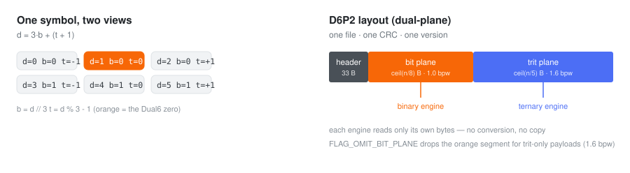
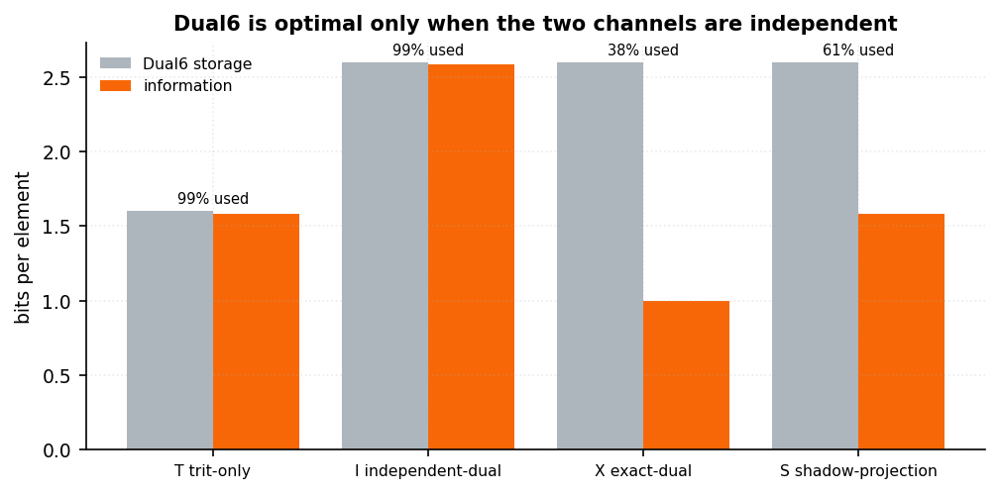
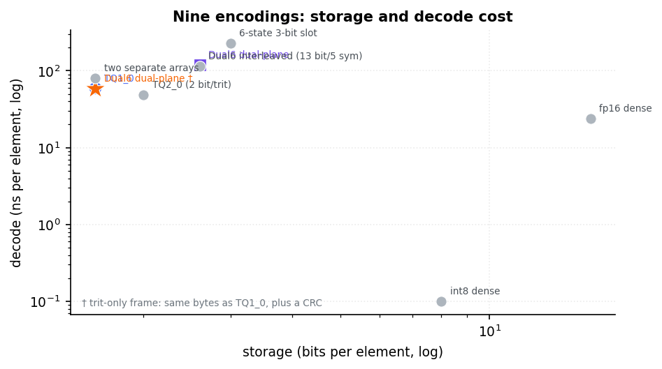
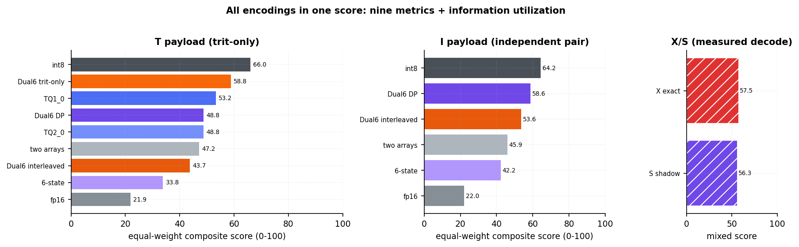
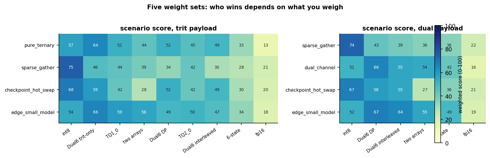
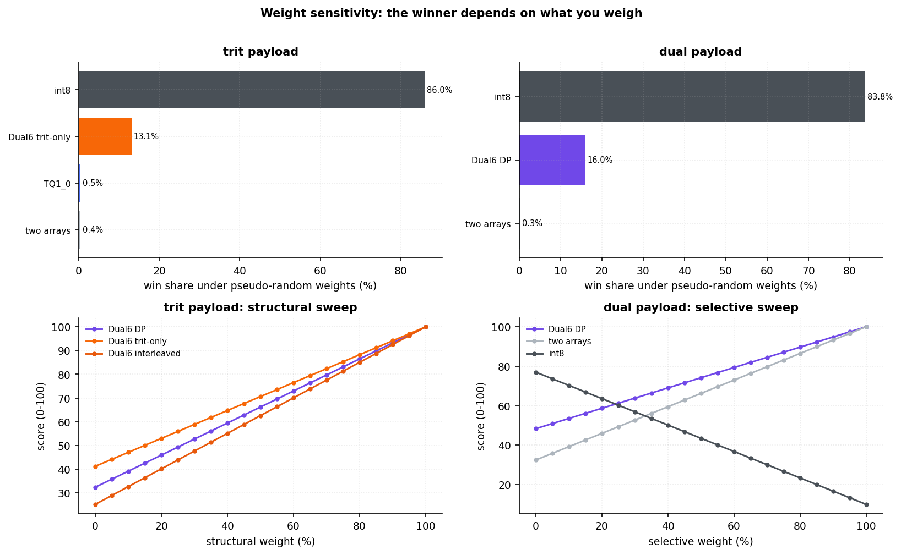
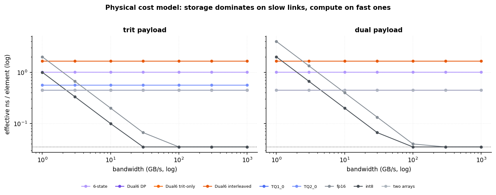
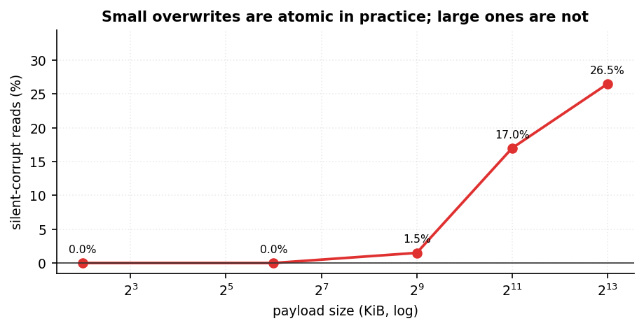
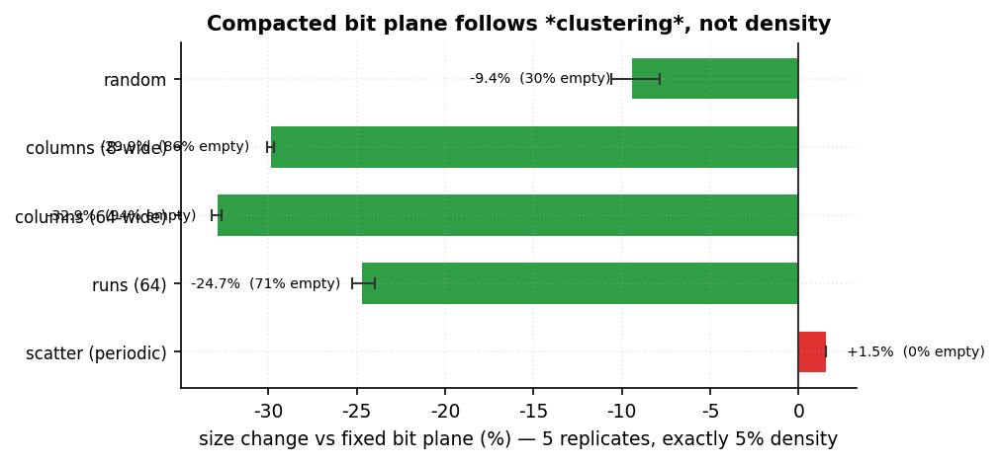
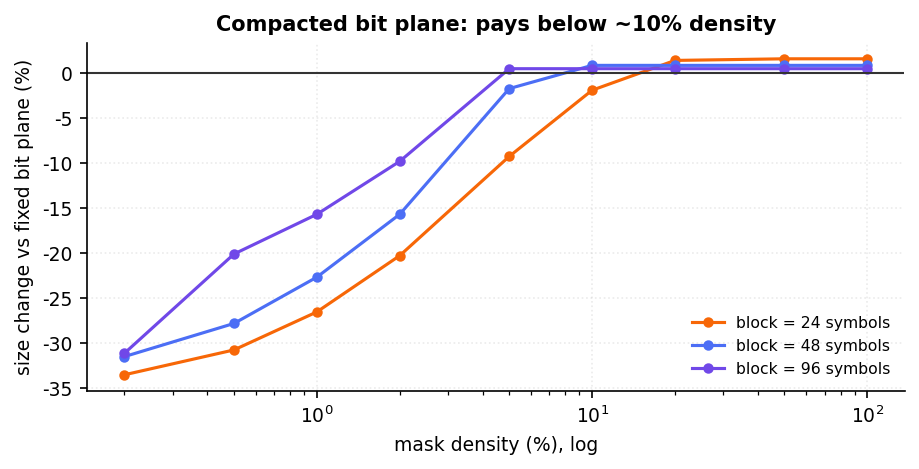

<h1 align="center">Dual6 · 二生三</h1>

<p align="center"><b>Binary–ternary hybrid storage: a measurement report.</b><br>
Dual6 is one implemented point in that design space, not the conclusion.</p>

<p align="center">
  <b>English</b> · <a href="README.zh-CN.md">简体中文</a>
</p>

<p align="center">
  
  
  
  
  
</p>

<p align="center">
  
</p>

```text
d = 3·b + (t + 1)        b = d // 3        t = d % 3 - 1

d ∈ {0..5}   b ∈ {0,1}   t ∈ {-1, 0, +1}
```

> **This is a storage container, not an accelerator and not a numeric type.**
> `d` is a *symbol*, not a base-6 digit. No arithmetic is defined on it.

---

## What this report is

This report asks one question:

> If binary and ternary engines ever share storage, which data models and
> encodings are worth considering?

It covers four data models (T, I, X, S), nine concrete encodings, and measured
storage, decode, random access, sparse gather, selective reads, integrity and
information utilization. It also includes scenario weights, a bandwidth model,
weight sensitivity, a real GPT-2 losslessness check, and fault injection.

Dual6 is one implemented point. The report does not claim it wins. Measured
`int8` wins the equal-weight composite on both measured payloads; Dual6 is
second. X is a different kind of candidate: a storage format for one value with
two native projections, useful only when shared-state coordination is expensive
enough to justify its redundancy.

## Naming

A model stored in this format is **one `.p6` file** — `llama-3-8b.p6`,
`bitnet-2b.p6` — not a directory of shards and sidecars.

`6` is the first perfect number (1 + 2 + 3 = 6), and it is also where the
encoding comes from: **2 states × 3 states = 6 states**.

The Chinese name is **二生三** (*èr shēng sān*), from the *Tao Te Ching*: "the one
gives birth to the two, the two give birth to the three". Two (binary) giving
birth to three (ternary), inside one symbol.

## The four data models

The same 6-state symbol can serve four different contracts. They must not be
mixed up.

#### Data models: T, I, X, S

| Model | Meaning | Info bits / element | Dual6 storage | Utilization | Interconvertible | Write semantics |
|---|---|---:|---:|---:|:-:|---|
| **T** trit-only | one balanced trit per element; no bit channel | 1.585 | 1.6 bpw | **99.1%** | no | update one trit (local) |
| **I** independent-dual | two independent channels per element | 2.585 | 2.6 bpw | **99.4%** | no | update bit or trit independently |
| **X** exact-dual | two expansions of one integer `N` | 1.000 | 2.6 bpw | **38.5%** | yes | recompute the middle symbol block for `N` |
| **S** shadow-projection | one trit plus a derived bit, e.g. `b = (t != 0)` | 1.585 | 2.6 bpw | **61.0%** | no | update trit, recompute derived bit |

- **T** is the pure-ternary case.
- **I** is the only model where the 6-state symbol is information-optimal.
- **X** stores one integer `N` twice inside each symbol: its base-2 digit and its
  balanced-base-3 digit. Both views reconstruct `N`. It is a storage format, but
  not a compression format; the redundancy buys dual native reads.
- **S** adds a channel that contains no new information. It is documented as a
  negative example, not recommended.

<p align="center">
  <br>
  <sub>Information versus Dual6 storage. T and I are near 100%; X is 38.5%;
  S is 61.0%.</sub>
</p>

#### Nine scored metrics

The scorecard uses nine measured metrics:

1. bits per element
2. encode time
3. decode time
4. random-access time
5. sparse-gather time
6. selective-read bytes
7. CRC/integrity flag
8. single-object flag
9. operations per element

The composite adds **information utilization** as a tenth metric. It is an
equal-weight descriptive aggregate, not a universal ranking.

#### Nine encodings

Nine concrete encodings are measured on the trit payload: fp16 dense, int8
dense, TQ1_0, TQ2_0, a 6-state 3-bit slot, three Dual6 layouts, and two separate
arrays. Six of them can also carry an independent `(bit, trit)` pair. X and S
are scored separately because they have no complete measured codec; their
decode paths are measured natively and the remaining timing metrics are marked
as proxies.

## Dual6 as one implementation

Dual6 implements **I** directly: `mux(bits, trits)` stores two independent
channels in one symbol stream. It implements **X** through the optional
`dual6.exact_dual` codec. **S** is specified as a non-recommended example.

### Layouts

| Layout | Symbols | Bytes | Used bits |
|---|---:|---:|---:|
| interleaved | 5 | 13 | `D = Σ dᵢ·6ⁱ` |
| `D6-64` | 24 | 8 | 63 / 64 |
| `D6-128` | 48 | 16 | 125 / 128 |
| `D6-40` | 40 | 13 | 104 / 104 |

| Dual-plane block | Bit plane | Trit plane | Total |
|---|---:|---:|---:|
| `D6-64-DP` | 3 B | 5 B | 8 B |
| `D6-128-DP` | 6 B | 10 B | 16 B |
| `D6-40-DP` | 5 B | 8 B | 13 B |

### Frames

| Frame | Header | Integrity | Purpose |
|---|---|---|---|
| `D6P0` | 17 B | — | minimal |
| `D6P1` | 20 B | CRC32 | one dual-plane stream |
| `D6P2` | 33 B | CRC32 | dtype, flags, block metadata |

Two `D6P2` options:

| Option | Effect |
|---|---|
| `FLAG_OMIT_BIT_PLANE` | drop the bit plane — pure-ternary payloads at **1.6 bpw** instead of 2.6 |
| `layout = 1` | compacted bit plane — one flag bit per block, bitmaps only for blocks with a set bit |

### Quick start

```bash
pip install -e .
python run_tests.py               # 326 tests
python tools/build_native.py      # optional Rust extension: same bytes, faster
```

```python
import dual6

bits = [1, 0, 1, 1]
trits = [1, -1, 0, 1]

symbols = dual6.mux(bits, trits)
assert dual6.demux(symbols) == (bits, trits)

frame = dual6.pack_dual_plane_v2(bits, trits)
assert dual6.unpack_dual_plane_v2(frame)[:2] == (bits, trits)
```

### X: one value, two native views

```python
from dual6 import exact_dual

symbols = exact_dual.encode_number(42)
assert exact_dual.read_binary(symbols) == 42
assert exact_dual.read_ternary(symbols) == 42
```

X has a global constraint, not a per-symbol one:

```text
Σ b_i·2^i = Σ t_i·3^i = N
```

That is why its information utilization is about `1 / log2(6) = 38.5%`: the
symbol space can hold 2.585 bits per symbol, but X uses it to carry one bit of
new information plus one redundant projection. A write recomputes the affected
middle symbol block; a read does no cross-base conversion.

## What was measured and how

The main scorecard has **15 rows** (9 trit payloads, 6 dual payloads) and **19
raw columns**. Timings are per element unless stated otherwise. Lower is better
for time, bytes and operations; integrity and single-object are binary flags.

The raw timings come from one machine and one harness. Absolute numbers do not
transfer; ordering and curve shape do. Native decode is a Rust microbenchmark,
or a `memcpy` floor for dense formats, marked with `†`. The floor is optimistic
for dense formats, which biases the comparison against bit-packed formats.

### Why compare many encodings

A storage format is a bundle of trade-offs, not one number. A format can win on
bytes, lose on decode, and still be the right choice for a checksummed
single-file artefact. The scorecard makes those trade-offs visible instead of
declaring one winner.

### Results

#### T payload: trit-only

| Encoding | bpw | encode ns | decode ns | native/floor ns | random ns | sparse 5% ns | sel bit B | sel trit B | CRC | one object |
|---|---:|---:|---:|---:|---:|---:|---:|---:|:-:|:-:|
| fp16 dense | 16.00 | 41.5 | 23.9 | 0.035† | 71.5 | 60.2 | 131072 | 131072 | — | — |
| int8 dense | 8.00 | 35.5 | 0.1 | 0.035† | 21.3 | 14.1 | 65536 | 65536 | — | ✓ |
| TQ1_0 (5 trit/byte) | 1.60 | 85.9 | 59.3 | 0.450 | 90.5 | 77.8 | 13108 | 13108 | — | ✓ |
| TQ2_0 (2 bit/trit) | 2.00 | 88.9 | 48.5 | 0.562 | 62.4 | 57.7 | 16384 | 16384 | — | ✓ |
| 6-state 3-bit slot | 3.00 | 269.6 | 230.4 | 1.015 | 114.1 | 103.5 | 24576 | 24576 | — | ✓ |
| Dual6 dual-plane | 2.60 | 160.6 | 119.1 | 0.448 | 211.5 | 170.5 | 8192 | 13108 | ✓ | ✓ |
| Dual6 dual-plane (trit-only) | 1.60 | 160.5 | 59.2 | 0.448 | 92.4 | 76.6 | 0 | 13108 | ✓ | ✓ |
| Dual6 interleaved (13 bit) | 2.60 | 156.2 | 113.6 | 1.648 | 343.6 | 319.9 | 21301 | 21301 | ✓ | ✓ |
| two separate arrays | 1.60 | 87.3 | 80.0 | 0.448 | 120.1 | 98.8 | 0 | 13108 | — | — |

† `memcpy_floor`: dense formats are not decoded; the number is an optimistic
copy floor used as a proxy.

The trit-only frame matches `TQ1_0` at **1.60 bpw** and **59.2 ns** versus 59.3
ns, while adding CRC32 and a single-object header. Dense `int8` stores 5× more
and decodes about **4.87×** faster on the raw metric; the clamped-net ratio is
much larger and is not a raw measurement. The only encodings carrying a
checksum are the three Dual6 ones.

`sel bit` / `sel trit` are the payload bytes a consumer of that channel must
read. Selective reads are why the dual-plane layout exists: on a dual payload
the bit channel needs **8192 B** and the trit channel needs **13108 B**, versus
**131072 B** for dense `int8`. The interleaved layout must read the whole stream
(21301 B).

<p align="center">
  <br>
  <sub>Storage against decode cost for the nine trit-payload encodings.</sub>
</p>

#### I payload: independent pair

| Encoding | bpw | encode ns | decode ns | native/floor ns | random ns | sparse 5% ns | sel bit B | sel trit B | CRC | one object |
|---|---:|---:|---:|---:|---:|---:|---:|---:|:-:|:-:|
| fp16 dense | 32.00 | 79.1 | 55.8 | 0.035† | 71.8 | 61.3 | 262144 | 262144 | — | — |
| int8 dense | 16.00 | 55.8 | 11.0 | 0.035† | 26.8 | 12.8 | 131072 | 131072 | — | ✓ |
| 6-state 3-bit slot | 3.00 | 280.3 | 231.7 | 1.015 | 105.0 | 101.2 | 24576 | 24576 | — | ✓ |
| Dual6 dual-plane | 2.60 | 163.3 | 125.6 | 0.448 | 232.0 | 178.5 | 8192 | 13108 | ✓ | ✓ |
| Dual6 interleaved (13 bit) | 2.60 | 167.8 | 112.8 | 1.648 | 330.3 | 319.4 | 21301 | 21301 | ✓ | ✓ |
| two separate arrays | 2.60 | 165.6 | 135.6 | 0.448 | 245.0 | 190.8 | 8192 | 13108 | — | — |

Only six encodings carry a `(bit, trit)` pair per element, so this table has six
rows. The independent pair costs **1.62×** the storage of T (2.60 vs 1.60 bpw).
That is the price of a genuinely independent second channel, not of a second
view of the same value.

#### Comprehensive score: T and I (equal weights)

Each row is scored with the nine metrics above plus information utilization:
`best / value` for lower-is-better metrics, 0/1 for flags, and
`utilization / 100` for efficiency. The composite is the mean × 100. The
denominator is the best value within the same payload group, so adding a new
encoding cannot silently change old scores.

**T payload (trit-only, measured):**

| Rank | Encoding | bpw | encode | decode | random | sparse | sel. | CRC | single | ops | util. | **Composite** |
|---:|---|---:|---:|---:|---:|---:|---:|:-:|:-:|---:|---:|---:|
| 1 | int8 dense | 0.200 | 1.000 | 1.000 | 1.000 | 1.000 | 0.200 | 0.000 | 1.000 | 1.000 | 19.8% | **66.0** |
| 2 | Dual6 trit-only | 1.000 | 0.221 | 0.002 | 0.231 | 0.184 | 1.000 | 1.000 | 1.000 | 0.250 | 99.1% | **58.8** |
| 3 | TQ1_0 | 1.000 | 0.413 | 0.002 | 0.235 | 0.181 | 1.000 | 0.000 | 1.000 | 0.500 | 99.1% | **53.2** |
| 4 | Dual6 dual-plane | 0.615 | 0.221 | 0.001 | 0.101 | 0.083 | 1.000 | 1.000 | 1.000 | 0.250 | 61.0% | **48.8** |
| 5 | TQ2_0 | 0.800 | 0.399 | 0.002 | 0.341 | 0.244 | 0.800 | 0.000 | 1.000 | 0.500 | 79.2% | **48.8** |
| 6 | two arrays | 1.000 | 0.406 | 0.001 | 0.177 | 0.143 | 1.000 | 0.000 | 0.000 | 1.000 | 99.1% | **47.2** |
| 7 | Dual6 interleaved | 0.615 | 0.227 | 0.001 | 0.062 | 0.044 | 0.615 | 1.000 | 1.000 | 0.200 | 61.0% | **43.7** |
| 8 | 6-state slot | 0.533 | 0.132 | 0.000 | 0.187 | 0.136 | 0.533 | 0.000 | 1.000 | 0.333 | 52.8% | **33.8** |
| 9 | fp16 dense | 0.100 | 0.854 | 0.004 | 0.298 | 0.234 | 0.100 | 0.000 | 0.000 | 0.500 | 9.9% | **21.9** |

**I payload (independent pair, measured):**

| Rank | Encoding | bpw | encode | decode | random | sparse | sel. | CRC | single | ops | util. | **Composite** |
|---:|---|---:|---:|---:|---:|---:|---:|:-:|:-:|---:|---:|---:|
| 1 | int8 dense | 0.163 | 1.000 | 1.000 | 1.000 | 1.000 | 0.100 | 0.000 | 1.000 | 1.000 | 16.2% | **64.2** |
| 2 | Dual6 dual-plane | 1.000 | 0.342 | 0.088 | 0.115 | 0.072 | 1.000 | 1.000 | 1.000 | 0.250 | 99.4% | **58.6** |
| 3 | Dual6 interleaved | 1.000 | 0.332 | 0.098 | 0.081 | 0.040 | 0.615 | 1.000 | 1.000 | 0.200 | 99.4% | **53.6** |
| 4 | two arrays | 1.000 | 0.337 | 0.081 | 0.109 | 0.067 | 1.000 | 0.000 | 0.000 | 1.000 | 99.4% | **45.9** |
| 5 | 6-state slot | 0.867 | 0.199 | 0.048 | 0.255 | 0.127 | 0.533 | 0.000 | 1.000 | 0.333 | 86.2% | **42.2** |
| 6 | fp16 dense | 0.081 | 0.706 | 0.198 | 0.373 | 0.210 | 0.050 | 0.000 | 0.000 | 0.500 | 8.1% | **22.0** |

**X/S: measured native decode, proxy other metrics.**

X and S have no complete scorecard codec. The Rust batch decode path is measured
(`X_demux` at about 23.8 ns/element, S trit unpack plus derived bit at about
30.8 ns); encode/random/sparse are borrowed from Dual6 dual-plane and marked as
proxies. These rows are useful in the same coordinate system, but they are not
equal-strength measurements.

| Rank | Encoding | Model | util. | **Composite** | Evidence |
|---:|---|---:|---:|---:|---|
| 1 | Dual6/S (shadow-projection) | S | 61.0% | **57.5** | native batch decode; other timing proxy |
| 2 | Dual6/X (exact-dual) | X | 38.5% | **56.3** | native batch decode; other timing proxy |

<p align="center">
  <br>
  <sub>Ten-metric equal-weight score. X/S use native batch decode; the remaining
  timing metrics are proxies.</sub>
</p>

Under equal weights, `int8` ranks first on both measured payloads (66.0 / 64.2).
Dual6 trit-only is second on T (58.8) and dual-plane is second on I (58.6). X is
a storage format, but it is not competing with `int8` on density: its real
competitors are two native copies plus synchronization, and one native copy plus
conversion on every dual read. That cost comparison is a separate experiment
and is not merged into this report.

#### Conditional weights: five scenarios

Equal weights are only one policy. These five scenarios change what matters.
Weights sum to 100 in every row; `both` means the scenario is scored separately
for trit and dual payloads, never across them.

| Scenario | Payload | bpw | encode | decode | random | sparse | selective | CRC | single | ops |
|---|---|---:|---:|---:|---:|---:|---:|---:|---:|---:|
| pure_ternary | trit | 30 | 5 | 20 | 5 | 5 | 5 | 15 | 10 | 5 |
| sparse_gather | both | 20 | 5 | 10 | 15 | 30 | 5 | 5 | 5 | 5 |
| dual_channel | dual | 20 | 5 | 15 | 5 | 10 | 25 | 10 | 5 | 5 |
| checkpoint_hot_swap | both | 10 | 10 | 10 | 20 | 5 | 5 | 20 | 15 | 5 |
| edge_small_model | both | 40 | 10 | 15 | 5 | 5 | 5 | 10 | 5 | 5 |

| Scenario | Payload | Winner | Score | Runner-up | Score |
|---|---|---|---:|---|---:|
| pure_ternary | trit | Dual6 dual-plane (trit-only) | 64.5 | int8 dense | 57.0 |
| sparse_gather | trit | int8 dense | 75.0 | Dual6 dual-plane (trit-only) | 46.3 |
| sparse_gather | dual | int8 dense | 73.8 | Dual6 dual-plane | 42.7 |
| dual_channel | dual | Dual6 dual-plane | 65.6 | Dual6 interleaved (13 bit) | 55.3 |
| checkpoint_hot_swap | trit | int8 dense | 68.0 | Dual6 dual-plane (trit-only) | 59.0 |
| checkpoint_hot_swap | dual | int8 dense | 67.1 | Dual6 dual-plane | 58.2 |
| edge_small_model | trit | Dual6 dual-plane (trit-only) | 65.6 | TQ1_0 (5 trit/byte) | 58.7 |
| edge_small_model | dual | Dual6 dual-plane | 66.9 | Dual6 interleaved (13 bit) | 64.5 |

<p align="center">
  <br>
  <sub>Five weight sets, one panel per payload. Winners are policy-dependent.</sub>
</p>

#### Weight sensitivity

Random integer weight vectors (5,000 draws per scheme, three deterministic
schemes) show how much the ranking depends on the weighting. On the trit
payload, int8 wins 85.6%–86.0% of draws and Dual6 trit-only wins 13.1%–13.6%.
On the dual payload, int8 wins 83.5%–83.9% and Dual6 dual-plane wins
15.6%–16.1%.

Dual6 only takes over when structural integrity, storage or selective-read
weights are raised far above their default importance. The exact flip points
are exported in `weight_sweeps.csv`; they are policy statements, not physical
constants.

<p align="center">
  <br>
  <sub>Win shares under random weights and one-dimensional flip sweeps.</sub>
</p>

#### Physical cost model

Timing alone is not a bandwidth model. For each encoding, the effective cost is

```text
effective_ns = max(decode_compute_ns, bytes_per_element / bandwidth)
```

At low bandwidth, compact formats win because memory dominates. At high
bandwidth, decode-compute dominates and dense formats win. The crossover is the
useful result, not one absolute winner.

| Bandwidth (GB/s) | trit winner(s) | effective ns | dual winner(s) | effective ns |
|---:|---|---:|---|---:|
| 1 | Dual6 dual-plane / Dual6 dual-plane (trit-only) / two separate arrays | 0.448 | Dual6 dual-plane / two separate arrays | 0.448 |
| 3 | int8 dense | 0.333 | Dual6 dual-plane / two separate arrays | 0.448 |
| 10 | int8 dense | 0.100 | int8 dense | 0.200 |
| 30 | int8 dense | 0.035 | int8 dense | 0.067 |
| 100 | fp16 dense / int8 dense | 0.035 | int8 dense | 0.035 |
| 300 | fp16 dense / int8 dense | 0.035 | fp16 dense / int8 dense | 0.035 |
| 1000 | fp16 dense / int8 dense | 0.035 | fp16 dense / int8 dense | 0.035 |

<p align="center">
  <br>
  <sub>Effective ns versus link bandwidth. Storage wins below 1–3 GB/s; compute
  wins above roughly 30 GB/s.</sub>
</p>

#### Model-level losslessness

The optional GPT-2 experiment ternarizes weights, stores them in Dual6 frames,
and reloads them. It validates **storage losslessness only**:

| Scope | Encoded elements | Dual6 bpw | Weights exact | Logits exact | Top-1 agreement | Notes |
|---|---:|---:|---|---:|---:|---|
| transformer linears | 84,934,656 | 1.604 | yes | yes | 100% | embedding/LayerNorm/bias kept fp16 |
| all 2-D weights | 124,318,464 | 1.604 | yes | yes | 100% | all 2-D weights ternarized |

Naive absmean ternarization destroys the original model: top-1 agreement with
fp16 is 3.1% for the linear-only scope and 0% for all 2-D weights. That is a
quantization result, not a storage result. The model weights are not in the
repository.

#### Fault injection

Fault injection into four containers under three update protocols shows that
silent corruption is decided by **a checksum and an atomic rename**, not by how
the bytes are packed. In-place same-size overwrite is invisible below 64 KiB,
starts to tear at 512 KiB, and grows from there:

| Payload | Silent reads / 200 | Silent |
|---:|---:|---:|
| 4 KiB | 0 | 0.0% |
| 64 KiB | 0 | 0.0% |
| 512 KiB | 3 | 1.5% |
| 2 MiB | 34 | 17.0% |
| 8 MiB | 53 | 26.5% |

<p align="center">
  <br>
  <sub>Silent corrupt reads versus payload size under in-place overwrite.</sub>
</p>

The same result holds for unrelated formats: a plain GGUF wrapped in a manifest
gets the same protection. This is **not a property of the container**.

### Limitations

- Absolute timings are machine-specific and not reproducible without the same
  harness and machine.
- X/S timing evidence is mixed: decode is native, other timing metrics are
  proxies.
- The benchmark's largest payload is 8 MiB; fault numbers come from synthetic
  containers, not production model serving.
- The per-element side channel that motivates I is **currently hypothetical**:
  today's formats avoid aligned second channels because they are expensive.
- The exact-dual encoder is still a Python per-digit implementation; native
  encode performance is future work.

## What the report found

**It is not faster, and the repository should be read that way.**

| Question | Answer |
|---|---|
| Which data models are information-optimal? | **T (99.1%)** and **I (99.4%)**; **X** is 38.5% and **S** is 61.0%. Only I makes the 6-state symbol information-optimal. |
| Is X a compression format? | **No.** X is a storage format for shared state: it pays redundancy for one stream, no copy synchronization, and zero read-time conversion. It should be compared with two native copies plus a sync protocol, not with `int8` on density. |
| What does an independent second channel cost? | **2.6 bpw** vs 1.6 for T — a **62.5% premium**. It pays only if something actually reads the second channel. |
| Is Dual6 faster? | No. Its trit-only mode is at `TQ1_0` parity: **1.60 bpw / 59.2 ns** vs 59.3 ns; dense `int8` decodes much faster. |
| What is the most transferable result? | Fault injection: silent corruption is decided by a **checksum + atomic rename**, not by byte layout; it starts between 64 KiB and 512 KiB on this machine. |

Three results survive:

1. **The T model reaches parity with the existing packing** at **1.60 bpw** and
   **59.2 ns**, while a frame adds CRC32 and a single-object header. That is a
   cheap integrity check for a pure-ternary payload.
2. **A compacted bit plane pays when the bit channel is a clustered mask**:
   **−25% to −33%** at 5% density, and a 1.5% cost when the mask is periodic.
   The rule is empty-block share, not density.
3. **The most useful result was not the encoding.** Silent corruption is decided
   by a checksum and an atomic rename, not by how the bytes are packed, and only
   appears above a size threshold (between 64 KiB and 512 KiB on this machine).
   That applies to any format, including the ones people already use.

The conclusion is a map, not a champion: **T** for pure ternary, **I** for an
independent side channel, and **S** not at all. **X** is a storage format with a
different objective: it is the mixed-era candidate to test when two native
readers repeatedly consume the same value. The scorecard can rank it, but cannot
decide whether the coordination savings justify its redundancy.

## Where it actually fits

Four conditions make Dual6 worth considering. Each one names what makes it wrong,
because a container that claims everything fits nothing.

**1 · A per-element side channel next to ternary weights** — `D6P2`, dual-plane

A ternary value and a per-element flag mask (outlier, prune, "use the
high-precision copy") read by the same kernel in the same pass. One stream, no
pointer chasing, no second file to fall out of sync. With a clustered mask,
`layout 1` saves **−25% to −33%**.

<p align="center">
  <br>
  <sub>Same 5% density, five arrangements, five replicates. Clustered masks save
  25–33%; periodic scatter costs 1.5%.</sub>
</p>

*Wrong when* the channels are not element-aligned. Most current formats avoid an
aligned second channel precisely because it is expensive. This scenario is
**currently hypothetical**: the container is ready for it, not proof that it
exists.

**2 · A pure-ternary model that wants one file and one checksum** — `D6P2`,
`FLAG_OMIT_BIT_PLANE`

Lands at **1.60 bpw and 59.2 ns/element**, the same as `TQ1_0` (1.60 / 59.3),
while adding CRC32 and a single-object frame. Cheap for slow media and small
machines: one `open`, one `mmap`, one checksum.

<p align="center">
  <br>
  <sub>Density sweep: the saving grows as the mask thins and disappears above
  about 10%.</sub>
</p>

*Wrong when* the data is already fast. A single frame is not faster to load:
measured equivalent at best, about 2% slower in repeated runs. On NVMe or a
cache-resident model the frame is pure overhead.

**3 · Hot-swapping a model while it is being served** — any frame, plus a protocol

Not a property of the container. Fault injection into four unrelated containers
showed that silent corruption is decided by **a checksum and an atomic rename**,
not by how the bytes are packed. A plain GGUF wrapped in a manifest gets the same
protection.

*What the measurements do say*: an in-place same-size overwrite is invisible
below **64 KiB**, starts to tear at **512 KiB** (1.5% of reads), and reaches
17% at 2 MiB and 26.5% at 8 MiB. If you rewrite a model file in place, you are
already exposed, whatever format it is in.

**4 · A loader that must be written in C, C++ or Rust** — `D6P1` / `D6P2`

One fixed header gives plane offsets; the bit plane is directly addressable and
the trit plane is the existing 5-trit/byte packing, so an existing ternary
kernel reads it unchanged. Embedding the container in an engine is a header
parse, not a parser.

*Careful with "zero copy"*: the bit plane is directly usable; the trit plane
still has to be unpacked, the way every 5-trit kernel already does.

### Where it does not fit

- pure ternary inference with no per-element metadata → use `TQ1_0`;
- anything that fits in cache → `int8` decodes an order of magnitude faster;
- cross-layer mixed precision, MoE routing tables, KV-cache layouts → the
  channels are not element-aligned, and none of the measurements apply;
- general compression → this is a storage container, not a codec;
- X as a general replacement for native storage → it is redundant by design and
  should be used only when dual native reads or shared-state coordination pay
  for the redundancy.

## Outlook

The open question is not another encoding score. It is whether mixed
binary–ternary execution ever makes shared state itself expensive. If it does,
X is the first candidate to test. If it does not, the container remains a
well-tested answer to a question no system is asking yet.

## Companion experiment

The three-way cost comparison for X — one shared symbol stream, two native
copies, or one copy plus conversion — is deliberately kept out of this report.
It lives in the standalone `x-hybrid-experiment` branch and is distributed as a
separate package. It adds no CSVs, tests or scores here.

## Status

**Dormant, not abandoned.** The container works and is tested; nothing new is
being added while the premise is unproven.

The premise is narrow: a binary engine and a ternary engine reading **the same
element** in the same pass. Today that only half-exists — ternary models such as
BitNet store ternary values but compute in FP16, so the bit channel has no
consumer. Two signals would change that:

1. a public model format whose per-element metadata is read alongside the
   weights (not per-tensor scales, not sparse indices);
2. ternary *compute* executing natively, instead of being unpacked to float.

## Scope

**In scope** — the symbol, sequence/layout/block packing, frames, error codes,
single-channel adapters.

**Out of scope** — value interpretation, quantisation, dtype/shape metadata,
tensor operators, and any model-format connector. The container carries bytes;
it does not explain them.

## Documentation

| File | Contents |
|---|---|
| [`docs/00-scope.md`](docs/00-scope.md) | what belongs in the container |
| [`docs/01-symbol.md`](docs/01-symbol.md) | the 6-state symbol |
| [`docs/02-sequence.md`](docs/02-sequence.md) | `mux` / `demux` |
| [`docs/03-layout.md`](docs/03-layout.md) | interleaved, dual-plane, fixed blocks |
| [`docs/04-frame.md`](docs/04-frame.md) | `D6P0` / `D6P1` / `D6P2`, flags, layouts |
| [`docs/05-errors.md`](docs/05-errors.md) | error codes |
| [`docs/08-api.md`](docs/08-api.md) | public API |
| [`docs/09-release.md`](docs/09-release.md) | build, test and release |
| [`docs/11-exact-dual.md`](docs/11-exact-dual.md) | X: one integer, two views |
| [`docs/12-arithmetic.md`](docs/12-arithmetic.md) | optional exact-dual arithmetic helper |
| [`docs/13-use-cases.md`](docs/13-use-cases.md) | where it fits, where it does not |
| [`benchmarks/README.md`](benchmarks/README.md) | what each CSV measured |
| [`tools/make_scores.py`](tools/make_scores.py) | rebuilds scenario and bandwidth CSVs |
| [`tools/make_charts.py`](tools/make_charts.py) | regenerates all nine charts |
| [`tools/model_roundtrip.py`](tools/model_roundtrip.py) | optional GPT-2 losslessness experiment |

## Repository layout

```text
python/dual6/      reference implementation (+ adapters, CLI, mmap)
crates/            dual6-core (Rust), dual6-py (PyO3), dual6-ffi (C ABI)
docs/              the specification, one topic per file
benchmarks/        19 CSVs (6 measured + 4 policy + 8 derived + 1 model), 9 charts
tests/             326 tests, including spec-derived ones
examples/          three runnable programs
tools/             check_all.py, coverage.py, verify_package.py, build_native.py, ...
```

## Tests

```bash
python run_tests.py                        # 326
DUAL6_BACKEND=ref python run_tests.py      # reference backend only
cargo test -p dual6-core                   # Rust core
```

[`tests/test_spec_from_scratch.py`](tests/test_spec_from_scratch.py) parses the
tables in `docs/01`–`docs/05` and checks the implementation against them.
[`tests/test_benchmark_data.py`](tests/test_benchmark_data.py) binds the CSVs in
`benchmarks/` to the tables and claims above.

## License

MIT — see [`LICENSE`](LICENSE).
