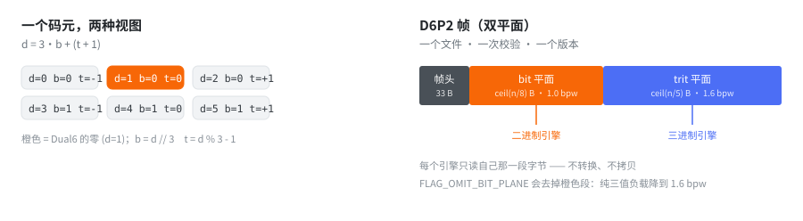

<h1 align="center">Dual6 · 二生三</h1>

<p align="center"><b>一个 6 态码元，同时装一个二进制位和一个平衡三进制位。</b><br>
为“二进制引擎和三进制引擎要读同一份字节”的那一天准备的存储容器。</p>

<p align="center">
  <a href="README.md">English</a> · <b>简体中文</b>
</p>

<p align="center">
  
  
  
  
  
</p>

<p align="center">
  
</p>

```text
d = 3·b + (t + 1)        b = d // 3        t = d % 3 - 1

d ∈ {0..5}   b ∈ {0,1}   t ∈ {-1, 0, +1}
```

> **这是一个容器，不是加速器，也不是数值类型。**
> `d` 是**码元**，不是 base-6 数字。它上面不定义任何算术。

---

## 命名

用这个编码存下来的模型，就是**一个 `.p6` 文件**——`llama-3-8b.p6`、
`bitnet-2b.p6`，而不是一堆分片加一堆 sidecar。

后缀取 `6`，因为 6 是第一个**完全数**（1 + 2 + 3 = 6），也正是这个编码的来源：
**2 态 × 3 态 = 6 态**。

中文名是**二生三**，取自《道德经》"道生一，一生二，**二生三**，三生万物"：
二（二进制）生三（三进制），就装在这一个码元里。

## 缘起

我最初只想知道一件事：**如果一台机器真的同时有二进制通路和三进制通路，
权重该怎么存，才能让两边都读得动？**

两个显而易见的答案都不好。存两份——于是有了两个文件、两次校验、两个会
互相漂移的版本。存一份、读时转换——于是总有一方要在热路径里付转换成本。

Dual6 是第三个答案：**把两种视图装进码元内部**，谁也不转换。

```text
d = 3·b + (t + 1)      一个码元，一个 bit，一个 trit
```

bit 通道取商，trit 通道取余。二进制消费者永远不看三进制位，反之亦然。
写入时把两种展开各算一次，读取时两边都不用算。

**这件事的起点是好奇，不是基准测试。** 下面那些数字，是我去找答案时量到的。

## 为什么

一个三值模型把 2 bit 的信息塞进 1.58 bit 的熵里；一个二进制模型只想要平铺
的 bit。今天要么二选一，要么存两份并保证同步。

Dual6 存**一份**制品，其中：

- 二进制消费者读 `d // 3` —— 一个平铺的 bit 平面；
- 三值消费者读 `d % 3 - 1` —— 5 trits/byte，与现有的 5-trit 打包**逐字节相同**；
- 两边都不需要转换、不需要第二次读、不需要第二份校验和。

两个平面在同一个文件里，同一次 CRC 之下，同一个版本号之下。

## 布局

| 布局 | 码元 | 字节 | 使用位数 |
|---|---:|---:|---:|
| 交错 | 5 | 13 | `D = Σ dᵢ·6ⁱ` |
| `D6-64` | 24 | 8 | 63 / 64 |
| `D6-128` | 48 | 16 | 125 / 128 |
| `D6-40` | 40 | 13 | 104 / 104 |

| 双平面块 | bit 平面 | trit 平面 | 合计 |
|---|---:|---:|---:|
| `D6-64-DP` | 3 B | 5 B | 8 B |
| `D6-128-DP` | 6 B | 10 B | 16 B |
| `D6-40-DP` | 5 B | 8 B | 13 B |

## 帧

| 帧 | 帧头 | 完整性 | 用途 |
|---|---|---|---|
| `D6P0` | 17 B | 无 | 最小格式 |
| `D6P1` | 20 B | CRC32 | 一条完整双平面流 |
| `D6P2` | 33 B | CRC32 | dtype、flags、块元数据 |

`D6P2` 的两个选项：

| 选项 | 作用 |
|---|---|
| `FLAG_OMIT_BIT_PLANE` | 去掉 bit 平面 —— 纯三值负载从 2.6 bpw 降到 **1.6 bpw** |
| `layout = 1` | 压缩 bit 平面 —— 每块 1 个 flag 位，只有含置位的块才存位图 |

## 快速开始

```bash
pip install -e .                  # 在仓库根目录
python run_tests.py               # 293 项测试
python tools/build_native.py      # 可选：构建 Rust 扩展（更快，输出字节相同）
```

```python
import dual6

bits  = [1, 0, 1, 1]
trits = [1, -1, 0, 1]

symbols = dual6.mux(bits, trits)                  # [5, 0, 4, 5]
assert dual6.demux(symbols) == (bits, trits)      # 两种视图，零转换

frame = dual6.pack_dual_plane_v2(bits, trits)     # D6P2，帧头 + CRC32
assert dual6.unpack_dual_plane_v2(frame)[:2] == (bits, trits)
```

### 内存映射帧

读一个大帧不一定非要把它拷进内存：

```python
from dual6 import MappedFrame, pack_dual_plane_v2, write_frame

frame = pack_dual_plane_v2([1, 0, 1, 1], [1, -1, 0, 1])
write_frame("tiny-model.p6", frame)

with MappedFrame("tiny-model.p6") as m:
    version, bits, trits, meta = m.unpack()       # version ∈ {0, 1, 2}
```

### Rust

核心是一个普通 crate。它**没有发布到 crates.io**，所以只能用 path 或 git 依赖：

```toml
[dependencies]
dual6-core = { path = "crates/dual6-core" }
# dual6-core = { git = "https://github.com/duyumengcctv/dual6", package = "dual6-core" }
```

```rust
let symbols = dual6_core::mux(&bits, &trits)?;
let (bits, trits) = dual6_core::demux(&symbols)?;
```

`DUAL6_BACKEND=ref|native|auto` 选择 Python 侧的实现；两套实现被要求
**逐字节一致**。

## 测量

原始数据在 [`benchmarks/`](benchmarks/README.md)——5 份 CSV 和 4 张图，
每份都附了测量方法与机器说明。

| 测了什么 | 结果 |
|---|---|
| trit-only `D6P2` vs `TQ1_0` | **1.60 bpw / 59.2 ns** vs 1.60 bpw / 59.3 ns —— 同一套字节布局，外加一次 CRC 和一个帧头 |
| 压缩 bit 平面（聚集掩码） | 5% 密度下 **−25% ~ −33%**；周期散射时 **+1.5%** |
| 就地同尺寸覆盖 + 裸加载器 | 静默损坏在 **64 KiB 到 512 KiB** 之间开始出现；8 MiB 时 26.5% 的读 |

综合评分表，九行里挑三行（完整表见 [`benchmarks/README.md`](benchmarks/README.md)）：

| 编码 | bpw | 解码 ns | 自带校验 | 单对象 |
|---|---:|---:|:-:|:-:|
| `int8` 稠密 | 8.00 | **0.1** | — | ✓ |
| `TQ1_0` | 1.60 | 59.3 | — | ✓ |
| **Dual6 trit-only 帧** | **1.60** | 59.2 | **✓** | ✓ |

<p align="center">
  <br>
  <sub>测试台里的全部编码。星号是 trit-only 帧：与 TQ1_0 同一套字节，外加一次 CRC。
  稠密编码解包快一个数量级，但存储要多五倍。</sub>
</p>

<p align="center">
  <br>
  <sub>无校验容器的就地同尺寸覆盖：64 KiB 以下为零，512 KiB 是 1.5%，8 MiB 是 26.5%。</sub>
</p>

## 结果

**它并没有更快，这个仓库应当以这种方式被阅读。**

| 问题 | 答案 |
|---|---|
| 解码更便宜吗？ | 不。trit 平面就是现有的 5-trit 打包，成本相同：trit-only 帧 **1.60 bpw / 59.2 ns**，`TQ1_0` 是 1.60 bpw / 59.3 ns。 |
| 存储更省吗？ | 双通道不省：**2.6 bpw** vs 纯三值的 1.6，溢价 **62.5%**。去掉 bit 平面就回到 1.6。 |
| 单帧加载更快吗？ | 不。最好情况是 ±5% 内等价，多轮重复下稳定慢约 2%。 |
| 第二个通道值这个价吗？ | 只有真的有人读它才值。在同时消费两个通道的融合 GEMV 里，成本大约翻倍。 |

活下来的有三样：

1. **trit-only 帧与现有打包持平**（1.60 bpw、同样的解码成本），却多了 CRC32
   和单对象帧——对纯三值负载来说，这是一次白得的完整性校验。
2. **压缩 bit 平面在 bit 通道是聚集掩码时划算**（5% 密度省 25%–33%），
   而在掩码是周期散射时反而贵 1.5%。**判据是全零块占比，不是密度。**
3. **最有用的结果不是这个编码。** 对四种容器、三种更新协议做故障注入后发现：
   静默损坏由**校验和 + 原子 rename** 决定，与字节怎么打包无关；而且它只在
   **超过某个尺寸阈值**之后才出现（本机是 64 KiB 到 512 KiB 之间）。
   这条结论对任何格式都成立，包括大家已经在用的那些。

诚实的总结：**一个只做一件事的容器（一份制品、两个视图、一次校验、一个版本），
它的价格只有在两个视图都真被消费时才划算。**

## 实际可能适用的场景

四种，每一条都写明**什么情况下它就不对**——一个声称什么都能装的容器，其实什么都装不了。

**1 · 三值权重旁边挂一条逐元素侧通道** —— `D6P2` 双平面

格式原本要服务的场景：三值主值 + 逐元素标志位（离群点、剪枝、"该用高精度副本"），
同一个 kernel 在同一遍里读两者。一条顺序流，没有指针跳转，没有第二个文件会失步。
掩码聚集时 `layout 1` 再省 **−24.7% ~ −32.9%**。

<p align="center">
  <br>
  <sub>同样 5% 密度、五种排列、每种 5 次重复。聚集掩码省 25–33%；周期散射反而贵 1.5%。</sub>
</p>

*什么时候不对*：两个通道不是逐元素对齐的。今天的格式基本都这样——
AWQ / OWQ 用 per-*channel* scale，SpQR / SqueezeLLM 用稀疏索引，
**正是因为对齐的第二通道更贵**。所以**这个场景目前是假设性的**：
容器为它准备好了，不代表它已经存在。

**2 · 纯三值模型，但想要一个文件、一次校验** —— `FLAG_OMIT_BIT_PLANE`

落在 **1.60 bpw、59.2 ns/元素**，与 `TQ1_0`（1.60 / 59.3）持平，另外白得 CRC32
和单对象帧。适合慢介质与小机器：一次 `open`、一次 `mmap`、一次校验。

<p align="center">
  <br>
  <sub>同一选项的密度扫描：掩码越稀收益越大，超过约 10% 后收益消失。</sub>
</p>

*什么时候不对*：数据本来就快。**单帧加载并不更快**——最好情况 ±5% 内等价，
多轮重复下稳定慢约 2%——在 NVMe 或 cache 驻留场景里，帧头是纯开销。

**3 · 边服务边热更新** —— 任何帧 + 协议

**这不是容器的性质。** 对四种互不相关的容器做故障注入表明：静默损坏由
**校验和 + 原子 `rename`** 决定，与字节怎么打包无关。普通 GGUF 套一层 manifest
能得到同样的保护。

测量到的是曲线形状：**64 KiB 以下看不到撕裂，512 KiB 是 1.5%，
2 MiB 是 17.0%，8 MiB 是 26.5%**。也就是说：只要你原地覆盖模型文件，
不管什么格式，超过 512 KiB 就已经暴露。

**4 · 加载器要写在 C / C++ / Rust 里** —— `D6P1` / `D6P2`

固定头部给出平面偏移；bit 平面可直接寻址，trit 平面就是现成的 5-trit/byte 打包，
现有三值 kernel 不用改。嵌入成本是一次头部解析。

*"零拷贝"要小心用*：bit 平面可以直接用，**trit 平面仍然需要解包**。

**明确不适用的地方**：

- 纯三值推理、无逐元素元数据 → 用 `TQ1_0`；
- 能整体进 cache → `int8` 的解码快一个数量级；
- 跨层混合精度、MoE 路由表、KV cache 布局 → 通道不对齐，本文所有测量都不适用；
- 通用压缩格式 → 这是容器，不是编解码器。

详细版（每一行都带测量出处）见 [`docs/13-use-cases.md`](docs/13-use-cases.md)。

## 展望

容器已经做完，缺的是一个用它的理由。两个信号能提供这个理由：

1. **需求侧。** 出现一种公开的模型格式，其**逐元素**元数据与权重一起被读取。
   今天的格式把 scale 放在组粒度、把离群点放成稀疏索引，正是为了**永远不需要**
   一条对齐的第二通道。
2. **供给侧。** 三值**运算**原生执行。今天所有"三值推理"路径在相乘之前都先
   解包成 FP16，所以 bit 平面没有读者。

任一信号出现，接下来的工作已经想好了：给 `layout 1` 加块索引，让随机访问回到 O(1)；
如果 bit 通道真的活了，再上 CRT 变体（用 `b = d % 2` 而不是 `d // 3`），
让两个通道的按位加同时无进位。**两者都是规格变更，不是重写。**

如果几年内两个信号都没出现，诚实的结局就是现在这样：一个完整、有测试、有文档，
只是暂时没人需要的容器。

还有一个必须写下来的限制：**这里没有任何一个测量跑在真实模型上。**
最大的载荷是 8 MiB，故障注入的数字来自单机上的合成容器。

## 状态

**待命，不是废弃。** 容器能用、有测试；前提未经验证之前不再加新功能。

前提很窄：二进制引擎和三值引擎**在同一遍里读同一个元素**。今天它只成立一半——
BitNet 这类三值模型存的是三值，算的是 FP16，bit 通道没有消费者。两个信号会改变这一点：

1. 出现一种公开的模型格式，其**逐元素**元数据与权重一起被读取
   （不是 per-tensor scale，也不是稀疏索引）；
2. 三值**运算**原生执行，而不是先解包成浮点。

在这之前，它就是一个有规格、有实现、有测量的容器。

## 范围

**属于容器层**——码元、序列/布局/块打包、帧、错误码、单通道适配。

**不属于**——数值语义解释、量化、dtype/shape 元数据、张量算子、任何模型格式连接器。
容器只负责搬运字节，不解释它们。

## 文档

| 文件 | 内容 |
|---|---|
| [`docs/00-scope.md`](docs/00-scope.md) | 容器层的边界 |
| [`docs/01-symbol.md`](docs/01-symbol.md) | 6 态码元 |
| [`docs/02-sequence.md`](docs/02-sequence.md) | `mux` / `demux` |
| [`docs/03-layout.md`](docs/03-layout.md) | 交错、双平面、固定块 |
| [`docs/04-frame.md`](docs/04-frame.md) | `D6P0` / `D6P1` / `D6P2`、flags、布局 |
| [`docs/05-errors.md`](docs/05-errors.md) | 错误码 |
| [`docs/08-api.md`](docs/08-api.md) | 公开 API |
| [`docs/09-release.md`](docs/09-release.md) | 构建、测试与发布 |
| [`docs/11-exact-dual.md`](docs/11-exact-dual.md) | 可选编解码：一个整数，两种视图 |
| [`docs/12-arithmetic.md`](docs/12-arithmetic.md) | 可选的 exact-dual 算术助手 |
| [`docs/13-use-cases.md`](docs/13-use-cases.md) | 适用 / 不适用 / 在等什么 |
| [`benchmarks/README.md`](benchmarks/README.md) | 每份 CSV 测了什么、在哪台机器上 |
| [`tools/make_charts.py`](tools/make_charts.py) | 从 CSV 重新生成全部四张图 |

## 仓库结构

```text
python/dual6/      参考实现（含适配层、CLI、mmap）
crates/            dual6-core（Rust）、dual6-py（PyO3）、dual6-ffi（C ABI）
docs/              规格文档，一个主题一个文件
benchmarks/        测量套件的 5 份 CSV + 4 张图
tests/             293 项测试，含“文档驱动”的规格测试
examples/          三个可直接运行的程序
tools/             check_all.py、coverage.py、verify_package.py、build_native.py 等
```

## 测试

```bash
python run_tests.py                        # 293
DUAL6_BACKEND=ref python run_tests.py      # 只用参考实现
cargo test -p dual6-core                   # Rust 核心
```

[`tests/test_spec_from_scratch.py`](tests/test_spec_from_scratch.py) 会**解析
`docs/01`–`docs/05` 里的表格**并逐条校验实现，所以规格或代码任何一边改了没同步，
构建就会失败。[`tests/test_benchmark_data.py`](tests/test_benchmark_data.py) 负责把
`benchmarks/` 里的 CSV 与上文引用的数字绑在一起。

**覆盖了什么**：容器往返、golden vectors、错误码、双后端一致性
（native 与参考实现必须逐字节相同）、property 与 fuzz 测试、以及 `D6P2` 的两个选项。

**没覆盖什么**：benchmark 的**脚本**不在这个仓库里，只有它们的输出在。早前的
完整工作档案报出更大的数字，是因为它额外带着图表、打包和文档守卫测试——没有那些
脚本，那些测试没有意义。

## 许可证

MIT —— 见 [`LICENSE`](LICENSE)。
